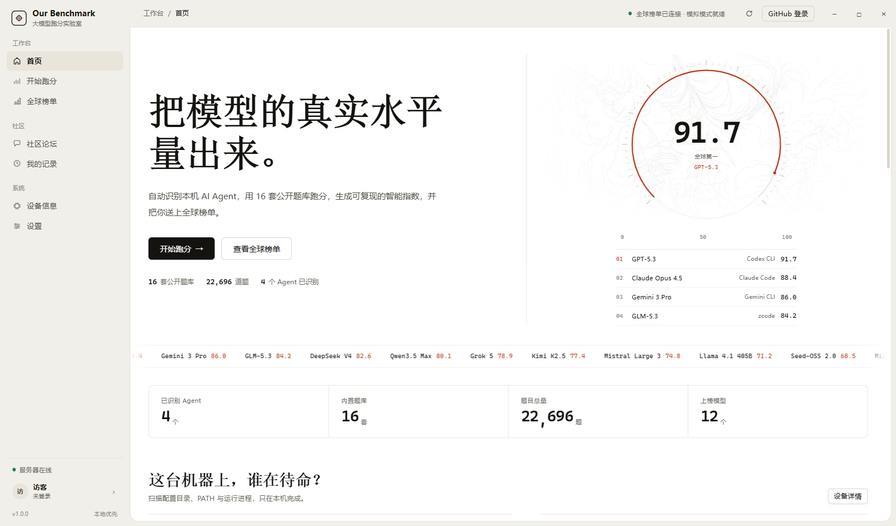
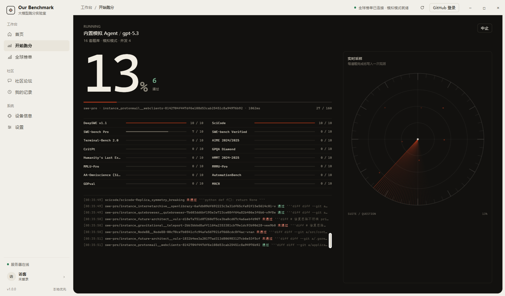
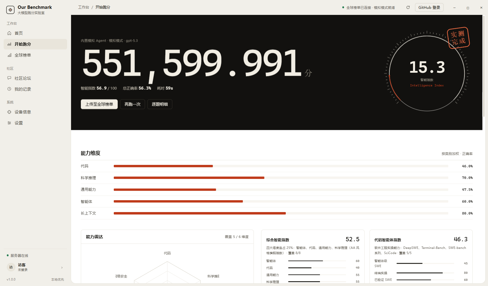
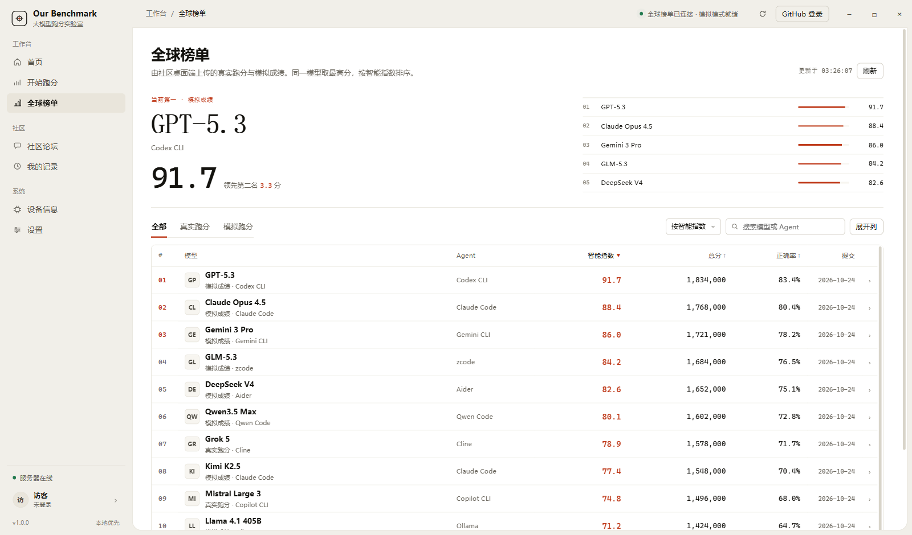

# Our Benchmark

> 安兔兔式的大模型桌面跑分工具 —— 自动识别你电脑上的 AI Agent，用 16 套开源权威题库给模型跑分，一键上传全球榜单。仿 Artificial Analysis 智能指数体系 + 社区论坛 + GitHub 登录。

## 界面预览

| 首页 · 流场 + 物理摆针表盘 | 跑分舱 · 暗色仪器 |
|---|---|
|  |  |

| 成绩 · 朱印盖章 | 全球榜单 · AA 式数据表 |
|---|---|
|  |  |

## 功能一览

### 桌面端（Electron，无边框纸张式仪器 UI）
- **Agent 自动识别**：扫描配置目录 / PATH / 运行进程，识别 Codex CLI、Claude Code、Gemini CLI、zcode、Cursor、Windsurf、Trae、Qwen Code、Copilot CLI、Aider 等
- **16 套公开题库**（见下表），内置采样子集开箱即用；每套可一键 **下载完整题库** 跑全量测试
- **Mock 跑分引擎**：确定性仿真能力画像，零 API 消耗跑通全流程；**真实模式**（CLI Agent / OpenAI 兼容 API）默认锁死，输入确认串才能解锁
- **评分器**：选项抽取 / 数值容差 / LaTeX boxed / 补丁相似度（SWE 类）/ 归一化简答
- **指数体系**（仿 AA）：Intelligence Index v4.3.2 四维（智能体/代码/通用/科学 ×25%）+ Coding Agent Index + Cyber Index + Decision Index
- 本地历史、设备信息页、逐题明细、访客/GitHub 登录、社区论坛、成绩上传与全球排名

### 服务端（Express，部署于 144.126.133.165:8600）
- REST API：成绩上传、全球榜单（多维排序/筛选）、个人成绩、论坛（发帖/回复/点赞）、统计
- GitHub OAuth（配好 `GITHUB_CLIENT_ID/SECRET` 即启用；未配置可用访客模式）
- **题库分发**：`/api/v1/datasets` 完整题库供桌面端按需下载
- 公开榜单网站（纸张式 AA 风格榜单）：`http://144.126.133.165:8600`

## 界面与设计

前端在 2026-10 做了一次完全重构，设计方向来自 [taste-skill v2](https://github.com/Leonxlnx/taste-skill) 的 `framed-sheet` 样式，并把品牌色改为“校准朱红”：

- **框架**：左侧栏 + 顶栏构成 L 型暖石色框架，内容放在一张白色纸张上；纸张只靠 1px 边线与一个色阶分隔，没有玻璃、渐变、霓虹和投影。
- **字体**：Noto Serif SC（大标题）、Noto Sans SC（界面）、IBM Plex Mono（数字与表格），全部本地打包，离线可用。
- **动效体系**（非线性曲线族 `--ease-out` expo 滑行 / `--ease-spring` 过冲回弹，rAF 补间统一由 `fx.js` 驱动）：
  - **界面切换**：View Transitions 方向感知转场（向下切页新页自下浮入、向上则自上落回），切页瞬间一根“校准扫描线”扫过纸张；进入跑分舱是暗舱快门、跑完自上而下揭幕出成绩。
  - **首页**：threeui 流场画布（改编自 [ThreeUI Community](https://github.com/MengTo/threeui) 的 Flow Field，MIT）+ 逐字压印的衬线大标题 + 物理摆针表盘（弧线、端点、读数同步缓动，重入平滑变针）+ KPI 数字滚轮（odometer）。
  - **跑分舱**：进度数字与进度条非线性滑翔逼近、逐题控制台、扫描盘；结果页有朱印“实测完成”盖章时刻。
  - **微交互**：侧栏滑动指示器、页签滑动下划线、主按钮光泽扫过与磁吸悬停、行悬停位移、对焦式（虚→实）滚动入场、数字滚动。
- **榜单**：仿 Artificial Analysis 的粘性表头、排序、搜索、展开列与行内六维雷达；公开榜单站使用同一套设计语言。
- **可访问性**：键盘焦点、`prefers-reduced-motion` 全面降级（转场/逐字/滚轮/盖章全部静止）、空/加载/错误状态齐全。

字体来自 Google Fonts（Noto 与 IBM Plex 均为 SIL OFL），已按中文字符集与拉丁子集打包到 `src/renderer/assets/fonts` 与 `server/public/fonts`。

## 题库套件（全部公开开源镜像，16 套 / 22,000+ 题）

| 套件 | 内容 | 类别 |
|---|---|---|
| SWE-bench Verified | 真实开源项目 Issue 修复（500 题） | 代码 |
| SWE-bench Pro | 高难度跨文件工程修复（642 题） | 代码 |
| Terminal-Bench 2.0 | 真实 Linux 终端工程任务（66 题） | 代码 |
| SciCode | 科学代码生成（64 题，沙箱执行官方测试真判分） | 代码 |
| DeepSWE v1.1 | 深度软件工程智能体（113 题） | 代码 |
| GPQA Diamond | 博士级科学考题（198 题完整集） | 科学 |
| AIME 2024/2025 | 高中数学奥赛（60 题） | 科学 |
| HMMT 2024-2025 | 哈佛-MIT 数学竞赛（90 题） | 科学 |
| CritPt | 物理科学推理（70 题，代码作答） | 科学 |
| Humanity's Last Exam | 人类最后一卷（2370 题文本版） | 通用 |
| MMLU-Pro | 研究生水平综合学科（12032 题） | 通用 |
| SimpleQA Verified | AA-Omniscience 公开等价物（1000 题） | 通用 |
| MMMU-Pro | 多模态推理文本子集（5190 题） | 通用 |
| GDPval | 真实职业场景智能体任务（107 题，OpenAI） | 智能体 |
| AutomationBench | 办公自动化工作流（94 题） | 智能体 |
| MRCR | 长上下文精准检索（100 题，OpenAI） | 长上下文 |

**未收录**（诚实说明）：
- CyberGym / ITBench-AA / Terminal-Bench-Science：纯容器/集群执行型基准，无文本可判分数据
- FrontierCode：公开镜像无数据文件
- AA 私有评测（AA-Briefcase、GDP.pdf、Harvey LAB-AA、SWE-Atlas-QnA 等）：无公开题库，UI 标灰展示、指数权重自动重分配

> 判分口径说明：SWE/Terminal/CritPt 类在桌面端采用与金标补丁/代码的 token-F1 相似度近似判分（官方需容器执行，属路线图）；SciCode 走本地 Python 沙箱执行官方测试用例真实判分；AutomationBench/GDPval 按关键值命中率。模拟模式的分数为确定性仿真数据，用于流程演示。

## 快速开始（开发）

```bash
git clone https://github.com/Ebony-Vinyl/our-benchmark.git
cd our-benchmark
npm install                 # 安装 Electron（国内走 npmmirror，见 .npmrc）
npm start                   # 启动桌面应用
npm run server              # 本地起服务端 :8600
npm test                    # 全部测试（评分器/引擎/服务器 API，零 API 消耗）
node test/e2e-electron.js   # Electron 全链路 E2E（跑分→登录→上传→榜单→论坛）
node test/visual-check.js   # 视觉检查：CDP 驱动 Electron，全页面×多宽度截图 + 渲染报错 + 横向溢出检测
```

> 完整题库不进仓库（27MB）：需要时运行 `python data/fetch_benchmarks.py` 抓取（经 hf-mirror），或直接由线上服务器 `/api/v1/datasets` 分发。
> 若 github.com 直连被断，为本仓库设置代理后再拉取/推送：`git config http.proxy socks5://127.0.0.1:7890`（端口按本机代理调整）。

## 目录结构

```
src/main/        Electron 主进程（检测/适配器/跑分引擎/评分器/指数/网络）
src/preload/     上下文桥
src/renderer/    纸张式 UI（外壳 / 流场 / 图表 / 七个页面）
benchmarks/      打包进应用的采样子集
data/            完整题库 + 抓取脚本
server/          服务端（API/论坛/OAuth/公开榜单站）
deploy/          部署脚本
test/            单元 + E2E 测试
```

## 安全与费用

- 真实模式三重闸门：设置页解锁开关 + 确认串 `I-UNDERSTAND-THE-COST` + 完整 API 配置，缺一不可
- API Key 仅存本机 `userData/store/settings.json`，永不上传
- 默认 Mock 模式永不产生任何 API 消耗

## 服务器部署

```bash
bash deploy/deploy.sh    # 打包→scp（SOCKS 代理）→装 Node22→systemd→健康检查
```

systemd 服务 `our-benchmark` 端口 8600；GitHub OAuth 凭据编辑 `/opt/our-benchmark/env` 后 `systemctl restart our-benchmark`。
